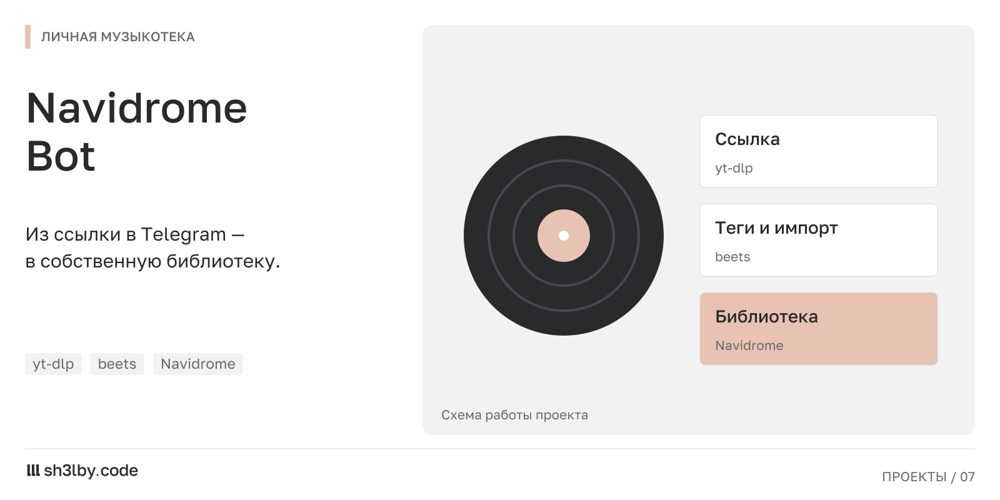

# NavidromeBot

<!-- portfolio-card:start -->
[](docs/portfolio/card.svg)
<!-- portfolio-card:end -->

Отправить музыку в Telegram и добавить её в собственную библиотеку Navidrome. Бот принимает аудиофайлы и разрешённые ссылки, ставит импорт в очередь и сообщает о результате.

Сценарий снимает ручную работу между телефоном и сервером: загрузку из ссылки выполняет `yt-dlp`, импорт в библиотеку обрабатывает `beets`. У задачи есть состояния загрузки, импорта, завершения и ошибки.

## Управление из привычного чата

Основной интерфейс построен на кнопках Telegram. Владелец может менять настройки через бота; они сохраняются в SQLite и имеют приоритет над значениями из `.env`. Доступ задаётся через `OWNER_ID` и необязательный список `ALLOWED_USER_IDS`.

Это пример автоматизации домашнего сервиса с очередью фоновых задач и обработкой внешних утилит. Развёртывание рассчитано на обычный Linux-хост: Python venv, systemd и каталоги `/srv/music`.

Обсудить похожий проект: [sh3l.beer](https://sh3l.beer).

## Установка

```bash
python3 -m venv .venv
source .venv/bin/activate
pip install -U pip
pip install -r requirements.txt
cp .env.example .env
```

Заполните `BOT_TOKEN`, `OWNER_ID` и при необходимости `ALLOWED_USER_IDS` в `.env`.

## Рабочие каталоги

```bash
sudo mkdir -p /opt/music-bot /srv/music/incoming /srv/music/library /srv/music/tmp /srv/music/bot-data /srv/music/beets
sudo chown -R $USER:$USER /opt/music-bot /srv/music
```

## Запуск и проверки

```bash
python3 -m app.main --check-config
python3 -m app.main
pytest
```

Для запуска через systemd установите `deploy/music-bot.service` в `/etc/systemd/system/music-bot.service`, затем выполните:

```bash
sudo systemctl daemon-reload
sudo systemctl enable --now music-bot
journalctl -u music-bot -f
```
